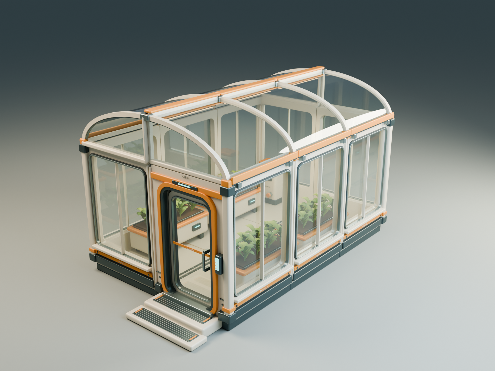

# 星邻计划 / Star Neighbors

项目暂名。多人合作、社交优先的未来卡通星球建造游戏：每个人拥有自己的星球，在持续扩展的共享宇宙里拜访朋友、寻找新家、共同建设。

**当前工作聚焦美术资产：居住舱 22 个、温室 12 个、建筑连接与室外平台 20 个、生活与社交道具 27 个、自然环境 24 个、种植与采集 28 个，共 133 个新版独立模型，跨套件复用不重复计数。优先确认造型、材质与模块拼接。此前 3D 结构样区与原生 2D 建造界面保留；正式角色、联机、星球生成、存档与承载人数尚未实现或验收。**

3D 星球、角色、建筑与环境承载主要游玩体验；2D 星图、界面、物品图标和社交反馈同步设计。当前样区使用 Estella，后续客户端及服务端能力按验收项逐步验证。


最新交付：[种植与采集模块](art/source/harvest-v1/README.md)、[可编辑场景](art/source/harvest-v1/harvest-v1.blend)、[28 个新增独立模型](art/models/harvest-v1/)、[生长阶段](art/reviews/harvest-v1/02-growth-stages.png)、[拆件图](art/reviews/harvest-v1/03-harvest-modules.png)、[矿物与资源](art/reviews/harvest-v1/05-resource-detail.png)、[容器拆分与成人尺度](art/reviews/harvest-v1/06-container-assembly.png)。三类作物各有三个阶段，果实、种植盒、藤架、箱盖、矿脉和碎矿独立；这里只交付静态美术，不包含生长和采集程序。

自然环境交付：[自然环境模块](art/source/nature-v1/README.md)、[可编辑场景](art/source/nature-v1/nature-v1.blend)、[24 个新增独立模型](art/models/nature-v1/)、[拆件图](art/reviews/nature-v1/03-nature-modules.png)、[入口近景](art/reviews/nature-v1/02-garden-arrival.png)、[树木拆分与成人尺度](art/reviews/nature-v1/06-tree-assembly.png)。包含 4 米地表、2 米小路、岩石、两套树干／树冠、灌木和花草地被；这里只交付美术资产与静态景观组合。

生活道具交付：[生活与社交道具](art/source/living-v1/README.md)、[可编辑组合](art/source/living-v1/living-v1.blend)、[27 个新增独立模型](art/models/living-v1/)、[拆件图](art/reviews/living-v1/03-living-modules.png)、[露台近景](art/reviews/living-v1/02-terrace-social.png)、[模块化与成人比例](art/reviews/living-v1/06-modularity-and-scale.png)。沙发座与扶手、柜体与门抽、层架、床品、礼盒盖均独立拆分。

建筑连接交付：[建筑连接与室外平台](art/source/connections-v1/README.md)、[可编辑组合](art/source/connections-v1/connections-v1.blend)、[20 个新增独立模型](art/models/connections-v1/)、[拆件图](art/reviews/connections-v1/03-connection-modules.png)、[组合剖视](art/reviews/connections-v1/02-connected-cutaway.png)、[直段／转弯／T 形走廊](art/reviews/connections-v1/05-passage-recipes.png)。L 形转角、温室过渡屋面、露台栏杆与高差件均独立拆分。

当前美术交付：[可编辑居住舱 Blender](art/source/habitat-v2/habitat-v2.blend)、[独立 GLB 模型](art/models/habitat-v2/)、[主要模块拆件图](art/reviews/habitat-v2/03-module-sheet.png)、[窗口细节](art/reviews/habitat-v2/02-window-detail.png)、[模块尺寸与交付说明](art/source/habitat-v2/README.md)。图为实际模型的离线渲染，尚未替换 Web 样区或通过最终美术验收。

同一套部件已拼成 [7×5 米与 13×9 米房间](art/reviews/habitat-v2/05-room-expansion.png)，并补充 [大房间剖视](art/reviews/habitat-v2/06-expanded-cutaway.png)。门洞净宽调整到 1.20 米，见 [1.78 米比例人偶同框检查](art/reviews/habitat-v2/07-doorway-scale.png)。这里验证的是美术拼装与尺度。



温室交付：[可编辑 Blender](art/source/greenhouse-v1/greenhouse-v1.blend)、[独立模型](art/models/greenhouse-v1/)、[拆件图](art/reviews/greenhouse-v1/03-garden-modules.png)、[种植床与灌溉设备](art/reviews/greenhouse-v1/02-growing-bed.png)、[尺寸和扩建方式](art/source/greenhouse-v1/README.md)。

此前的 [Web 样区](art/reviews/engine-day.png) 用于检查尺寸、拆件和操作，其窗面仍是反光色板、温室尚未封玻璃；地表、远景和植被仍需细化。灰色人形是 1.78 米比例参照，正式人物见 [待评审参考视图](art/references/settler-reference.png)。

可编辑源文件：[Blender 模块与样区](art/source/star-neighbors-art-sample.blend)。项目入口：[project.esproject](project.esproject)。

## 操作与运行

- WASD 移动观察镜头，Q/E 升降，按住右键环视，Home 回到全景。
- B 开关建造，1/2/3 选择地板/种植箱/储物箱，方向键按 2 米移动，R 旋转，Enter 放置。
- Backspace 或“撤回”收回最后一个部件；Esc 退出建造；N 切换日夜灯光。
- 界面按钮与键盘使用同一套操作。庭院最多展示 8 个新增部件，刷新即重置；这个数量只是试作对象池大小。

在仓库根目录执行：

```powershell
node pipeline/bin/estella.mjs export games/star-neighbors --out output/star-neighbors/web
python -m http.server 8080 --directory output/star-neighbors/web
```

浏览器访问 `http://localhost:8080`。生成、导入和无界面验证的完整步骤见 [模块化制作约定](docs/07-modular-production.md)。

## 策划文件

| 文件 | 内容 |
| --- | --- |
| [原型策划案](docs/01-prototype-design.md) | 游戏定位、已确认设定、世界结构、合作循环与原型范围 |
| [细节玩法草案](docs/02-gameplay.md) | 社交、探索、随机星球、建造、资源、轻风险与首小时流程 |
| [美术方向讨论稿](docs/03-art-direction.md) | 三种独立风格图、场景/角色/建筑/2D UI 的比较标准 |
| [联机与持久化设计](docs/04-network-and-persistence.md) | 分区、共享状态、权限、跨区转移、离线结算与容量边界 |
| [原型里程碑与验收](docs/05-milestones.md) | 交付顺序、验收案例、观察指标和未验证事项 |
| [决策记录](docs/06-decisions.md) | 已确认、建议采用、等待看图选择的事项 |
| [模块化制作约定](docs/07-modular-production.md) | 部件规格、材质、代码职责、复现与未完成项目 |

## 当前共识

- 多人合作是基础；每位玩家有自己的星球，星球能够被朋友访问和共同建设。
- 宇宙持续扩展，按星区、星球和地表区块组织；不以固定小队人数作为全宇宙合作人数上限。
- 社交为主，有一定风险，反馈以正向或中性为主，尽量减少惩罚。
- 星球尺度随机；玩家可以探索并寻找更大的星球。概率、大小范围和占有规则尚未定稿。
- 美术以 [用户选定的温暖科幻参考](art/concepts/selected-warm-sci-fi.png) 为主：保留成年角色比例、自然植被层次和清楚的材质差异。此前进一步简化为塑料玩具感的 A 图不作为制作基准。

## 目录

```text
star-neighbors/
  README.md
  docs/                 策划、玩法、美术、联机与验收
  art/
    concepts/           风格参考，尚非运行时资产
    references/         待评审的角色多视图
    prompts/            图像完整制作描述
    source/             可编辑 Blender、规格、清单和装配布局
    reviews/            实际日夜截图与检查结果
  assets/               独立模型/预制体、共享材质、天空、场景
  src/                  镜头、建造、灯光、界面与状态
  tools/                模型构建、导入、装配及无界面验证
```

文档中的数值是用于讨论和验证的初始参数；验收目标不代表功能已经实现。项目暂名不代表正式游戏名称。
