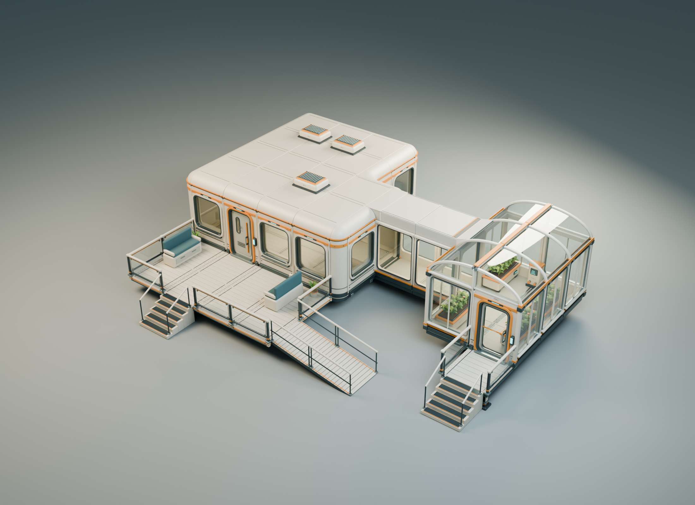

# 建筑连接与室外平台 · 第一版

20 个新增独立模型，复用 30 个已有居住舱、温室模型。保留暖白涂装、赭橙标识、深色框架和透明玻璃。本包只交付模型、材质与装配参考。



## 文件

- [可编辑 Blender](connections-v1.blend)：`LIBRARY` 保存拆开的建模零件和依赖，`ASSEMBLY` 使用共享网格实例；灯光、背景和拆件展示单独保存。
- [20 个独立 GLB](../../models/connections-v1/)、[尺寸与接口清单](asset-catalog.json)、[288 个实例的组合布局](assembly.json)。依赖引用既有文件，不复制成另一套资产编号。
- [剖视图](../../reviews/connections-v1/02-connected-cutaway.png)、[主要拆件图](../../reviews/connections-v1/03-connection-modules.png)、[导出文件重组图](../../reviews/connections-v1/04-export-roundtrip.png)。
- [直段／转弯／T 形走廊](../../reviews/connections-v1/05-passage-recipes.png)、[走廊拼装源文件](passage-studies.blend)、[三种拼装布局](passage-recipes.json)。图中隐藏屋顶以展示通道，源文件保留独立屋顶实例。
- [内凹角和住宅接口](../../reviews/connections-v1/06-corner-and-dock.png)、[露台近景](../../reviews/connections-v1/07-terrace-detail.png)、[温室过渡罩](../../reviews/connections-v1/08-garden-connection.png)。所有图片均为实际网格的离线渲染。

## 新增模型

| 类别 | 独立模型 | 数量 |
| --- | --- | --- |
| 内凹转角 | foundation-inner-corner-2m、wall-inner-corner-2m、roof-inner-corner-2m | 3 |
| 建筑接口 | junction-frame-2m、dock-head-2m | 2 |
| 走廊 | corridor-wall-glass-2m、corridor-roof-2m、junction-post | 3 |
| 露台 | deck-floor-2m、deck-edge-2m、deck-corner-cap | 3 |
| 栏杆 | deck-rail-2m、deck-post-105 | 2 |
| 架空支撑 | support-foot-020、support-riser-040 | 2 |
| 高差连接 | terrace-stair-081、terrace-ramp-2m、ramp-rail-2m | 3 |
| 温室过渡屋面 | garden-link-roof-glass、garden-link-hood-2m | 2 |

## 拼装约定

源文件以米计、Z 向上；GLB 为 Y 向上。模型原点和安装点记录在清单及 GLB 根对象中。全部示例保持部件缩放为 1，不整体拉伸门窗、走廊或建筑。

**内凹角需要替换相邻两条边各自的首个 2 米边段。** 原点放在中心地板网格的凹角，两个墙面接点为 `(2, 0.5, 0)` 和 `(0.5, 2, 0)`。地板、墙和屋顶分别安装；其曲率、内侧填补与外凸角不同，不能仅靠翻转既有圆角件代替。示例采用 14 块中央地板组成 L 形，中央地板面积为 56 平方米，外围另有补边。

走廊沿 2 米网格重复：地板复用居住舱地板，侧墙、平顶和接柱为独立件。转弯与 T 形通过相邻格共享开口拼成，无需把整段走廊合成新模型。走廊名义宽 2 米，连接框直边之间净宽 1.60 米；圆角会缩小顶部局部宽度。

居住舱接口使用开放连接框和独立顶盖，把原卷边屋檐接到走廊平顶。温室接口替换一块侧墙和该格朝接口的一片半跨玻璃；短玻璃与金属过渡罩分开交付。原弧形骨架及其他屋面格保留。示例走廊长 4 米，两端连接住宅与温室；温室西侧种植床已移开通道。

露台为 8×4 米：地板底面标高 0.60 米，名义行走面标高 0.81 米，与两栋建筑及走廊一致。支脚 0.20 米，支撑段 0.40 米。栏杆横段与立柱分别放置，转角共用立柱；开放入口不跨放栏杆。

楼梯总高 0.81 米，共五级、每级名义高 0.162 米。坡道由两段 2 米模块连接，每段升高 0.405 米，总水平长度 4 米；坡道栏杆独立。踏面纹理与边缘标识有毫米级凸起，不能用装饰包围盒顶面代替安装基准。当前仅提供这组高差，未制作任意坡度与任意楼层高度的变体。

## 美术交付状态

当前为干净涂装的第一轮美术稿。透明材质沿用 `KHR_materials_transmission`；贴图嵌入 GLB，Blender 保留可编辑部件和打包贴图。旧模型文件没有被重写。

[导出检查](../../reviews/connections-v1/asset-check.json) 覆盖所有新件和依赖的独立导入、尺寸、有限坐标/UV、面数、退化面与嵌入贴图。[接口检查](../../reviews/connections-v1/interface-check.json) 核对内凹墙接点、坡道拼缝、楼梯和露台标高，以及温室侧门的种植床布置。

尚未制作多层楼梯间、室内隔墙系统、伸缩或异形高差件、磨损贴花、LOD、简化碰撞网格及活动部件动画。渲染与几何检查不代表结构承载、角色动态通行或设备性能验收。

## 后台复现

从仓库根目录运行，既有两套模型需已存在。以下命令只在后台处理美术文件：

```powershell
& 'C:/Program Files/Blender Foundation/Blender 5.2/blender.exe' --background --factory-startup --python-exit-code 1 --python games/star-neighbors/art/source/connections-v1/build_connections.py
& 'C:/Program Files/Blender Foundation/Blender 5.2/blender.exe' --background --factory-startup --python-exit-code 1 --python games/star-neighbors/art/source/habitat-v2/check_exports.py -- --kit connections-v1
& 'C:/Program Files/Blender Foundation/Blender 5.2/blender.exe' --background --factory-startup --python-exit-code 1 --python games/star-neighbors/art/source/connections-v1/render_details.py
```
