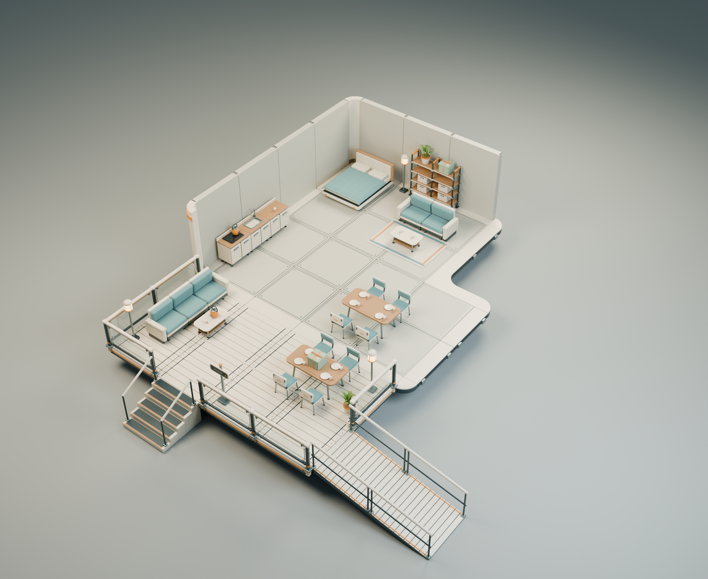

# 生活与社交道具 / living-v1

延续米白外壳、赭橙识别件、深色金属骨架与青绿色织物，加入木质台面、亚麻床品和陶瓷餐具。全部为真实模型的离线渲染，当前交付只包含美术与静态拼装参考。

27 个新增独立 GLB，复用 17 个已交付建筑和盆栽模型；住宅与露台剖视共 218 个实例。与居住舱、温室、连接套件合计 **81 个新版独立模型**，跨套件引用不重复计数。



## 文件

- [可编辑主场景](living-v1.blend)：原始拆件保存在 `LIBRARY / Independent modules`，实例组合保存在 `ASSEMBLY / furnished home cutaway`。屋顶及南、东侧墙在本展示组合中省略，完整建筑仍在原套件中。
- [27 个独立 GLB](../../models/living-v1/)：每件独立导入，纹理嵌入文件，导出副本按材质合并，源文件仍保留建模零件。
- [资产规格](asset-catalog.json)、[住宅布置](assembly.json)、[拆装示例布局](modular-studies.json)、[拆装示例 Blender](modular-studies.blend)。
- [露台近景](../../reviews/living-v1/02-terrace-social.png)、[完整拆件图](../../reviews/living-v1/03-living-modules.png)、[室内细节](../../reviews/living-v1/05-interior-detail.png)、[模块化与成人比例](../../reviews/living-v1/06-modularity-and-scale.png)。
- [导出重组渲染](../../reviews/living-v1/04-export-roundtrip.png)、[GLB 检查](../../reviews/living-v1/asset-check.json)、[尺寸与布置检查](../../reviews/living-v1/scale-and-fit-check.json)。

## 模块与尺度

单位为米。Blender 为 Z 向上；GLB 为 Y 向上，坐标转换为 `(x, z, -y)`。通常家具正面朝 Blender 的 -Y。规格文件中的 `nominal` 是设计规格，`sourceDimensionsXYZ` 与 `sourceBoundsXYZ` 是实际网格尺寸和包围范围，包含斜腿、把手、布边等突出部分。

| 分组 | 独立模块 | 装配约定 |
| --- | --- | --- |
| 桌椅、茶几 | `dining-table-180`、`dining-chair`、`coffee-table-110` | 餐桌 1.80×0.90，台面高 0.76；餐椅坐高 0.48；茶几台面高 0.41 |
| 拼接沙发 | `sofa-seat-090`、`sofa-arm` | 每座宽 0.90，坐高 0.47；连续重复座位，独立扶手放在两端 |
| 床与床品 | `bed-frame-160`、`mattress-160`、`bed-quilt-160`、`bed-pillow` | 床垫 1.60×2.00；床架、床垫、被子、枕头分离 |
| 柜子 | `cabinet-frame-100`、`cabinet-door-050`、`cabinet-drawer-100` | 柜体按 1 米间距并排；柜门与抽屉为不同组合选项 |
| 置物架 | `shelf-upright-180`、`shelf-board-090` | 支架高 1.80；每跨 0.90；连续两跨只需要 3 根支架 |
| 厨房 | `kitchen-counter-100`、`kitchen-sink-top-100`、`induction-hob`、`kettle`、`mug`、`dinner-plate` | 普通台面与水槽台面互换；灶面、壶、杯、盘单独摆放 |
| 收纳与软装 | `storage-basket-040`、`woven-rug-240` | 收纳筐可放入层架；地毯主体 2.40×1.65，短穗略伸出 |
| 灯与路牌 | `outdoor-lantern-160`、`wayfinding-post`、`wayfinding-panel` | 灯高约 1.60；灯罩有发光材质；路牌面板可替换，当前为静态 WELCOME 字样 |
| 礼物 | `gift-box-040`、`gift-lid-040` | 盒身与盖子分离；盖子有内沿间隙，示例提供闭合与抬盖状态 |

拆件图中壶、杯、盘放大 3 倍，筐、灶面、礼盒放大 2 倍，均在图上标注；住宅与成人尺度图中的实际实例比例全部为 1。灰色 1.78 米人偶复用旧样区资产，仅作比例参照。

## 拼装方式

- **沙发**：N 个座位中心位于 `x = (i - (N-1)/2) × 0.90`；两侧扶手中心位于 `x = ±(N×0.45 + 0.075)`。沙发不是一整块不可拆模型，展示组合使用两座与三座，尺度图使用一座与两座。
- **床**：床架落地；床垫底部安装在 `z=0.30`；被子原点在 `z=0.40`，网格本身带侧边下垂；两个枕头底部在 `z=0.50`，中心位于 `x=±0.40, y=0.71`。被子和枕头是静态网格。
- **柜子**：柜体落地；台面原点为 `z=0.86`，完成台面高 `0.90`。左右柜门原点分别为 `(-0.25,-0.327,0.18)`、`(0.25,-0.327,0.18)`。柜门原点在底部中心，两侧铰链位置由 `sourceSockets` 指明；开启示例绕右铰链转动 65°。
- **抽屉**：柜体内闭合位置为 `(0,-0.315,0.63)`；拆装图沿 -Y 拉出 0.22。抽屉用于敞开下层的柜体组合，与整高柜门二选一。未提供抽屉滑轨机构或动画。
- **层架**：支架中心间距 0.90；层板底面为 `z=0.2675 / 0.6675 / 1.0675 / 1.4675`，板厚 0.04；筐放在层板上表面。层间净高 0.36，带盖礼盒和盆栽放在顶层，避免穿过上层板。
- **路牌**：面板中心安装在支柱 `(0,-0.07,1.28)`，也预留低位 `z=0.94`；修改文字需替换面板模型或编辑源零件。
- **礼盒**：盒底原点落地；盖子原点在 `z=0.325`，盖沿向下 0.024。内开口 0.414，盒身含包带最大 0.410，最小单侧间隙 0.002；示例中的抬盖仅表达独立部件关系。

水槽网格局部向台面以下延伸，礼盒盖内沿也在原点以下。这两件的原点是装配面，不是包围盒最低点。不能把所有模型都按最低点归零后再套用上述布局。

## 验证与交付边界

无界面 Blender 检查涵盖全部 GLB 的包围范围、三角面数量、有限顶点与 UV、退化三角面和嵌入纹理，并重新导入、重建住宅展示。另检查桌椅高度差、床垫尺寸、台面接口、沙发及层架间距、礼盒盖间隙，以及家具包围范围是否侵入预留通道。

主入口预留 1 米宽的直行路线；坡道上端另留通道。这里只检查家具静态布置，尚未验证角色碰撞、坐下动画、寻路或实际引擎性能。灯的局部照明、柜门与抽屉交互由程序接入。尚未制作 LOD、碰撞代理、动作与磨损贴花，也未将这批模型替换到旧 Web 样区。

在仓库根目录复现：

```powershell
& 'C:/Program Files/Blender Foundation/Blender 5.2/blender.exe' --background --factory-startup --python-exit-code 1 --python games/star-neighbors/art/source/living-v1/build_living.py
& 'C:/Program Files/Blender Foundation/Blender 5.2/blender.exe' --background --factory-startup --python-exit-code 1 --python games/star-neighbors/art/source/habitat-v2/check_exports.py -- --kit living-v1
& 'C:/Program Files/Blender Foundation/Blender 5.2/blender.exe' --background --factory-startup --python-exit-code 1 --python games/star-neighbors/art/source/living-v1/review_living.py
```
