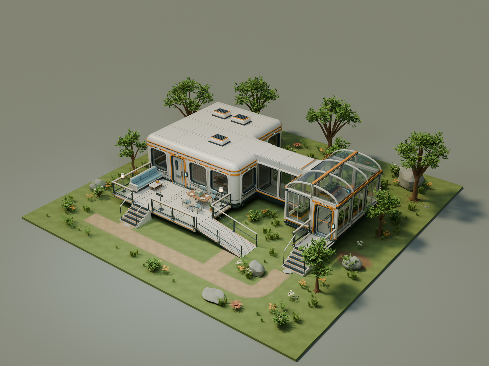

# 自然环境模块 / nature-v1

温暖科幻住宅的自然环境配套：橄榄绿枝叶、赭黄花朵、浅色花簇、暖灰岩石与少量铜红异星植物。叶片使用弯折几何面片，树冠由枝叶组成。建筑和家具复用原有交付。

24 个新增独立 GLB，新增模型合计约 8.9 万个三角面。复用 60 个已交付模块；展示场景共 588 个实例，包含 36 块地表及 8 棵由树干、树冠分别拼成的树。项目累计 **105 个新版独立模型**，复用不重复计数。



## 交付文件

- [可编辑主场景](nature-v1.blend)：原始建模零件在 `LIBRARY / Independent modules`，场景实例在 `ASSEMBLY / garden neighborhood`。
- [24 个独立 GLB](../../models/nature-v1/)、[资产规格](asset-catalog.json)、[展示布局](assembly.json)。导出按材质合并，每件独立保存；源文件保留枝干、叶片组、岩石与小路分带。
- [完整拆件图](../../reviews/nature-v1/03-nature-modules.png)、[入口近景](../../reviews/nature-v1/02-garden-arrival.png)、[植物细节](../../reviews/nature-v1/05-botanical-detail.png)。
- [树干／树冠与成人尺度](../../reviews/nature-v1/06-tree-assembly.png)、[树木拆分源文件](tree-studies.blend)、[树木参考布局](tree-studies.json)。
- [GLB 重导入渲染](../../reviews/nature-v1/04-export-roundtrip.png)、[导出检查](../../reviews/nature-v1/asset-check.json)、[拼接与布置检查](../../reviews/nature-v1/assembly-check.json)。

## 模块

| 类别 | 独立模块 | 用途 |
| --- | --- | --- |
| 地表 | `terrain-meadow-4m`、`terrain-loam-4m` | 4×4 米草地与带土壤斑块的草地；外围边界保持相同位置与高度 |
| 小路 | `path-straight-2m`、`path-turn-2m`、`path-junction-2m` | 2 米网格上的直段、转角和 T 形节点；土路中心和边缘过渡分开建模 |
| 踏脚石 | `stepping-stone-060` | 约 0.6 米的不规则石板，连接小路与建筑落脚处 |
| 岩石 | `boulder-large-250`、`boulder-medium-120`、`rock-slab-160`、`pebble-cluster-060` | 大石、中石、低岩板、碎石簇，可旋转复用 |
| 成树 | `tree-trunk-mature`、`tree-crown-mature` | 树干、主枝与树冠分离；树冠包含细枝和叶片 |
| 幼树 | `tree-trunk-young`、`tree-crown-young` | 第二种尺度和轮廓；仍使用两个独立部件 |
| 灌木 | `shrub-rounded-090`、`shrub-flowering-080` | 常绿灌木、浅色开花灌木 |
| 蕨与草 | `fern-clump-060`、`grass-tuft-035`、`grass-clump-065` | 独立蕨丛、小草束、高草簇 |
| 花与异星植物 | `flower-amber-045`、`flower-ivory-055`、`alien-rosette-070` | 暖黄野花、浅色野花、铜红莲座状植物 |
| 地面点缀 | `moss-patch-100`、`ground-leaf-litter-080` | 低矮苔藓与落叶，打散重复地表的外观 |

名称与 `nominal` 是设计规格；旋转枝叶、倾斜石块和不规则轮廓的准确范围以清单中的 `sourceDimensionsXYZ`、`sourceBoundsXYZ` 为准。拆件图对较大的树和较小的草花使用了标明倍率的展示缩放，主场景与成人比例图均为原始比例。

## 模块化与安装

1. **坐标和原点**：一单位为一米。Blender 为 Z 向上；GLB 为 Y 向上，坐标转换为 `(x,z,-y)`。植物与树干原点是根部；石块是底部参考点。树冠原点与配套树干相同，位于地面，不能把树冠按自身最低点归零。
2. **地表**：每块边界为 `x/y=±2`，上表面 `z=0`，底部 `z=-0.16`。采用平坦拼装面，颗粒细节通过颜色和法线图表达。按 4 米重复、绕 Z 轴旋转 90° 的整数倍仍保持边界衔接；土壤款外围也是草地，中心土壤覆盖层高出 0.0015 米。
3. **小路**：网格为 2 米，直段朝南北；中心土路宽 1.10 米，连同过渡带约宽 1.66 米。直段接口在 `(0,±1,0)`；转角接口在 `(0,-1,0)` 与 `(1,0,0)`；T 形接口在 `(-1,0,0)`、`(1,0,0)`、`(0,1,0)`。原点标记的是地面安装位置，路中心最高约 0.027 米。
4. **树木**：同一套树干、树冠使用完全相同的位置与旋转；`crown-*` 接点记录枝条末端，可用来核对树冠对应关系。现有成树和幼树是一对一配套，不能直接互换不同尺寸树冠。
5. **植物组合**：草、灌木、花、蕨、苔藓与落叶各自独立，展示使用原始比例和不同旋转。当前布局把植物根部和岩石下埋 0.008 米，落叶直接放在地表；这是静态美术布置，不包含地形贴合程序。
6. **材质**：石、树皮、草地、土路附带颜色和法线图；GLB 内嵌纹理。叶片无需透明贴图，保留双面材质。苔藓和落叶为几何簇，允许与地面轻微重叠。

展示地块为 **24×24 米**，住宅、温室、露台和小路只用于观察模块搭配。边缘是地表模块的真实切面；未制作远景地形或整颗星球。

## 检查与后续

导出检查逐件核对 GLB 尺寸、三角面、UV、嵌入资源及退化面，并重新导入、重组渲染。布局检查核对地表边界与相邻接点、直段／转角／T 形小路的接点、树干与树冠配对、成人尺度，以及主要土路通道中的低矮植被。

当前是静态美术交付。尚未制作 LOD、风动权重、碰撞代理、采集状态或破坏状态；未替换旧 Web 样区，也未验证引擎中的植被批处理、光照或设备性能。检查报告中的面数用于评估资产规模，不代表帧率验收。

在仓库根目录复现：

```powershell
& 'C:/Program Files/Blender Foundation/Blender 5.2/blender.exe' --background --factory-startup --python-exit-code 1 --python games/star-neighbors/art/source/nature-v1/build_nature.py
& 'C:/Program Files/Blender Foundation/Blender 5.2/blender.exe' --background --factory-startup --python-exit-code 1 --python games/star-neighbors/art/source/habitat-v2/check_exports.py -- --kit nature-v1
& 'C:/Program Files/Blender Foundation/Blender 5.2/blender.exe' --background --factory-startup --python-exit-code 1 --python games/star-neighbors/art/source/nature-v1/review_nature.py
```

首次排查几何时可设置 `NATURE_SKIP_RENDER=1` 只生成源文件与模型；设 `NATURE_CHECKS_ONLY=1` 可让评审脚本跳过渲染。最终交付需要完整生成并查看预览图。
