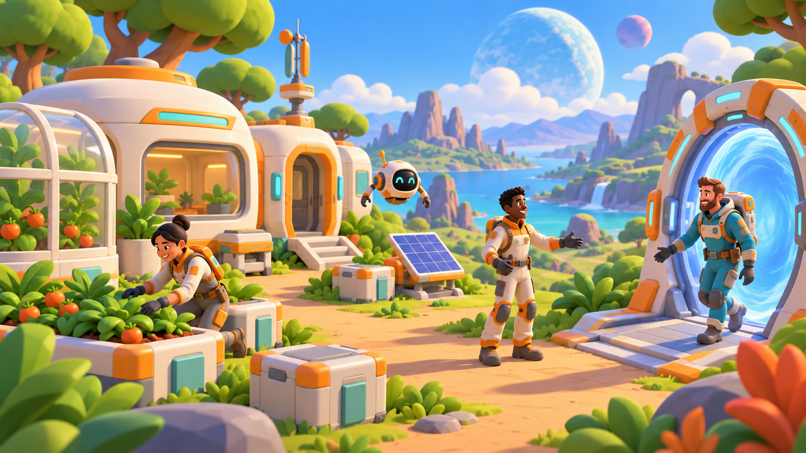
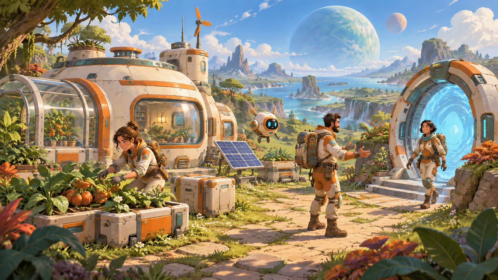
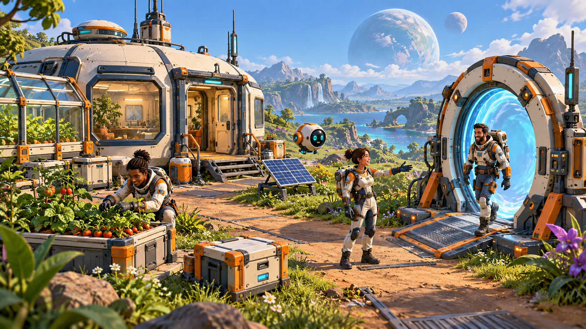

# 美术方向讨论稿

日期：2026-10-22。状态：三种候选均未确认。用户希望每个方向各有一张独立图片，看图后再选择。

## 1. 比较方式

三张图采用相同的场景描述：外星草地上的小型家园、居住舱与温室、访客门、太阳能设备、种植箱、货箱、圆形维修机器人，以及正在到访/欢迎/种植的三名成年拓荒者。镜头为略微俯视的第三人称场景，天空包含大小不同的远处星球。

每张图保持相同的主要物件与活动，重点比较轮廓、材质、地表与工业细节。图像是风格概念稿，不是已实现的游戏截图；独立绘制的画面在布局和角色细节上可能存在差异。最终只能通过相同资产的引擎样区确认实时效果与成本。

## 2. 三个独立候选

### A：温暖玩具科幻

[查看独立图片](../art/concepts/a-warm-toy-sci-fi.png)

圆润厚实的轮廓、清晰大色块、哑光涂层、少量金属结构。角色和设备有可触摸的体积感，树木以块状树冠组织，岩石保留简洁的面。

适合传达：安全的家园、容易接近的科技、朋友来访的轻松氛围。

重点验证：是否过于幼态；设备用途能否看清；大量重复模块是否单调；地形与建筑能否区分材质。

### B：清新绘本科幻

[查看独立图片](../art/concepts/b-painted-storybook-sci-fi.png)

保留 3D 体积，采用手绘色彩变化、柔和明暗、自然的植物轮廓与插画感天空。科技设施仍然有明确结构和占地。

适合传达：值得探索的自然、星球之间的景色差异、园艺和环境变化。

重点验证：纹理在远景是否变脏；模块拼接的笔触是否连续；动态光照下是否仍统一；2D 图标能否与场景保持清楚的视觉层次。

### C：硬朗卡通工业

[查看独立图片](../art/concepts/c-cartoon-industrial-sci-fi.png)

更明确的倒角、支架、面板、连接件和可读机械结构。维持明亮环境与友好角色，以受控的机械细节表达开拓感。

适合传达：建设的功能感、模块组合、合作施工与设备升级。

重点验证：细节是否妨碍采集物辨认；远景是否碎；玩家能否一眼分辨可交互接口；模型制作工作量是否可控。

## 3. 三个方向共用的视觉目标

- 主情绪为温暖、可亲近和好奇；危险通过局部事件表现。
- 角色、可采集物、道路和放置空间首先可辨认，氛围效果不能淹没操作信息。
- 每位玩家可选基地配色；颜色变化不改变功能。功能状态还需图标、动作或文字。
- 天空和轨道视角表达星球大小差异；地面保持容易判断距离与行走方向的参照。
- 3D 环境与 2D UI 同步验收：星图、建造菜单、好友状态、物品图标、权限提示不延后到美术定稿后补做。

## 4. 待定的角色与环境参数

| 项目 | 初始建议 | 尚需验证 |
| --- | --- | --- |
| 人物 | 约 4.5 头身的成年拓荒者，面部可见、手套和背包略夸张 | 看图后确认是否调整为更自然比例 |
| 服装 | 基础工作服 + 可换色外层 + 可辨认工具 | 动作范围、背包遮挡与多人识别 |
| 建筑 | 统一连接尺寸，屋体、窗、门、温室组合 | 网格吸附、内外尺度与装饰自由度 |
| 植物 | 形状与成熟变化清楚，少量发光种类 | 夜间辨识与大量种植的性能 |
| 地表 | 大块材质分区，草/土/岩石边界自然 | 跨区块连续、坡面和建筑接地 |
| 光照 | 昼夜保留温度差，夜晚仍可辨认路径 | 低配置画面、阴影成本与灯光数量 |
| 配色 | 奶白、橙、青绿为比较基准，正式配色待选择 | 三种风格在同等色彩下的表现 |

## 5. 2D UI 与交互反馈

星图分清“我的家”“好友家”“公共目的地”“未知信号”，用图形和标签共同表达；星球规模未知时不伪装为精确数据。访问按钮显示权限、在线状态及目的地是否可进入。

建造菜单优先显示缩略图、占地、材料和功能。放置预览用轮廓和符号区分有效/无效状态，并明确失败原因。多人施工显示位置已被占用，而不是无提示撤销玩家操作。

社交信息采用小幅动画、表情和短提示；完成共同工程时允许大家停留合影。控制弹窗频率，不把画面变成不断滚动的奖励列表。

## 6. 风格选择的评审方式

先选择最想长期居住的场景，再比较建筑可读性和角色亲近感。一个方向作为主体，其余方向仅吸收明确元素，避免同时混用不同材质语言。

看图后的下一步是一个完整样区：基础角色、机器人、居住舱、访客门、种植箱、树、岩石、地面，以及对应 2D 建造卡片/物品图标/好友到访提示。先确认同屏效果，再扩展资产数量。

完成标准：同场景日/夜可读；角色动作尺度合理；建筑能在网格中拼接；UI 不遮挡放置位置；局部多人和目标设备性能通过相应检查。概念图好看不能替代这些验收。

## 7. 候选图完整描述

- [A 图完整描述](../art/prompts/a-warm-toy-sci-fi.txt)
- [B 图完整描述](../art/prompts/b-painted-storybook-sci-fi.txt)
- [C 图完整描述](../art/prompts/c-cartoon-industrial-sci-fi.txt)

最终风格确认后更新 [决策记录](06-decisions.md)，保留未选方向作为讨论历史，不将其混入正式资产。
